<!-- ───────────────────────────── HERO ───────────────────────────── -->

  

  
  
  
  

  
  
  

<!-- ───────────────────────────── ABOUT ───────────────────────────── -->
<h2>
  
  About Me
</h2>

<table>
<tr>
<td width="60%" valign="top">

I'm a **Full Stack Developer with 5+ years of experience** turning ideas into production-ready **web and mobile apps**. As a **Senior Full Stack Developer** at a product startup, I own a SaaS product end to end: the web app, the React Native mobile app and the backend behind them.

 &nbsp;Shipped **6+ production projects** across SaaS, events, education &amp; industry 
 &nbsp;Built and launched **React Native** apps for Android &amp; iOS 
 &nbsp;Improved **web app performance** for a live SaaS product 
 &nbsp;Integrating **AI features** with Claude, OpenAI, Gemini &amp; LangChain 
 &nbsp;Mentor newer developers through **code reviews** 
 &nbsp;Build native **macOS apps in Swift** on the side (SnapText is open source)

</td>
<td width="40%" valign="top">

| ⚡ | **Quick Facts** |
|:-:|:--|
| 💼 | Senior Full Stack Developer |
| 🗓️ | 5+ years · since 2021 |
| 📍 | Indore, India · IST (UTC+5:30) |
| 🌍 | Remote-ready, worked with global clients |
| 🎯 | Open to full-time &amp; contract roles |
| ⏱️ | Replies within 24 hours |

</td>
</tr>
</table>

<!-- ───────────────────────────── STRENGTHS ───────────────────────────── -->
<h2>
  
  What I Bring to a Team
</h2>

<table>
<tr>
<td align="center" width="33%">
 
<b>End-to-End Ownership</b> 
&#8203;From first idea to launch &amp; support
</td>
<td align="center" width="33%">
 
<b>Modern Frontend</b> 
&#8203;Next.js, React, TypeScript, Tailwind
</td>
<td align="center" width="33%">
 
<b>Cross-Platform Mobile</b> 
&#8203;React Native for Android &amp; iOS
</td>
</tr>
<tr>
<td align="center">
 
<b>Backend &amp; APIs</b> 
&#8203;Node.js, NestJS, REST, GraphQL, real-time
</td>
<td align="center">
 
<b>AI Integration</b> 
&#8203;LLM features with Claude, OpenAI &amp; Gemini
</td>
<td align="center">
 
<b>Quality &amp; Teamwork</b> 
&#8203;Code reviews, tests, mentoring
</td>
</tr>
</table>

<!-- ───────────────────────────── TECH STACK ───────────────────────────── -->
<h2>
  
  Tech Stack
</h2>

<table>
<tr>
<td width="150"><b>🎨 Frontend</b></td>
<td></td>
</tr>
<tr>
<td><b>⚙️ Backend</b></td>
<td></td>
</tr>
<tr>
<td><b>📱 Mobile</b></td>
<td></td>
</tr>
<tr>
<td><b>🗄️ Database</b></td>
<td></td>
</tr>
<tr>
<td><b>☁️ Cloud &amp; DevOps</b></td>
<td></td>
</tr>
<tr>
<td><b>🧠 AI</b></td>
<td>

</td>
</tr>
<tr>
<td><b>🛠️ Tools</b></td>
<td></td>
</tr>
<tr>
<td><b>📦 Libraries</b></td>
<td>

</td>
</tr>
</table>

<!-- ───────────────────────────── EXPERIENCE ───────────────────────────── -->
<h2>
  
  Experience
</h2>

<table>
<tr>
<td width="170" valign="top" align="center">
 
<b>2024 — Now</b>
</td>
<td valign="top">

**Senior Full Stack Developer** · *Product Startup* · 🟢 Remote · Full-time

- Own a **SaaS product end to end**: web app, mobile app and server
- Built the **React Native app** for Android &amp; iOS
- Made the web app **faster** and easier to work on
- Mentor newer developers through **code reviews**

<code>Next.js</code> <code>React Native</code> <code>TypeScript</code> <code>Node.js</code> <code>MongoDB</code> <code>AWS</code>

</td>
</tr>
<tr>
<td valign="top" align="center">
 
<b>2022 — 2024</b>
</td>
<td valign="top">

**Full Stack Developer** · *Software Agency* · 📍 Indore, India

- Delivered websites, web apps and mobile apps for **e-commerce, logistics and education** clients
- Led projects **from the first client meeting to launch**
- Built **React Native** apps and a library of **reusable components** for the team

<code>React</code> <code>Next.js</code> <code>React Native</code> <code>Node.js</code> <code>Express.js</code> <code>MongoDB</code>

</td>
</tr>
<tr>
<td valign="top" align="center">
 
<b>2021 — 2022</b>
</td>
<td valign="top">

**Web Developer** · *Tech Startup* · 📍 Indore, India

- Built websites and their **REST APIs**
- Integrated **online payments** and third-party services
- Wrote the team's **first automated tests**

<code>JavaScript</code> <code>React</code> <code>Node.js</code> <code>Express.js</code> <code>MongoDB</code>

</td>
</tr>
</table>

<!-- ───────────────────────────── PROJECTS ───────────────────────────── -->
<h2>
  
  Featured Projects
</h2>

<table>
<tr>
<td width="50%" valign="top">

</td>
<td width="50%" valign="top">

</td>
</tr>
<tr>
<td width="50%" valign="top">

</td>
<td width="50%" valign="top">

</td>
</tr>
<tr>
<td width="50%" valign="top">

</td>
<td width="50%" valign="top">

</td>
</tr>
</table>

  

<!-- ───────────────────────────── PROCESS ───────────────────────────── -->
<h2>
  
  How I Work
</h2>

<!-- ───────────────────────────── ACTIVITY ───────────────────────────── -->
<h2>
  
  GitHub Activity
</h2>

  

  <picture>
    <source media="(prefers-color-scheme: dark)" srcset="https://raw.githubusercontent.com/tausif40/tausif40/output/snake-dark.svg" />
    <source media="(prefers-color-scheme: light)" srcset="https://raw.githubusercontent.com/tausif40/tausif40/output/snake-light.svg" />
    
  </picture>

<!-- ───────────────────────────── CONTACT ───────────────────────────── -->
<h2 align="center">
  
  Hiring? Let's talk.
</h2>

  I'm open to <b>full-time</b> and <b>contract</b> roles, remote or on-site. 
  The fastest way to reach me is email or LinkedIn. I reply within 24 hours.

  
  
  

