<!-- ───────────────────────────── HERO ───────────────────────────── -->

  
  
  

<!--  -->

<!-- ───────────────────────────── INTRO ───────────────────────────── -->
<!-- 

  

 -->

<!-- ───────────────────────────── WHAT I DO ───────────────────────────── -->
<h2>
  
  What I Do
</h2>

  

<!--  -->

<!-- ───────────────────────────── OPEN SOURCE ───────────────────────────── -->
<h2>
  
  Open Source Projects
</h2>

<!-- Add the next open-source project here, using the same card + buttons layout. -->

<!--  -->

<!-- ───────────────────────────── ACTIVITY ───────────────────────────── -->
<h2>
  
  GitHub Activity
</h2>

  

  

<!-- ───────────────────────────── FOOTER ───────────────────────────── -->
<!--  -->

  
  
  
  
  
  
  

  

