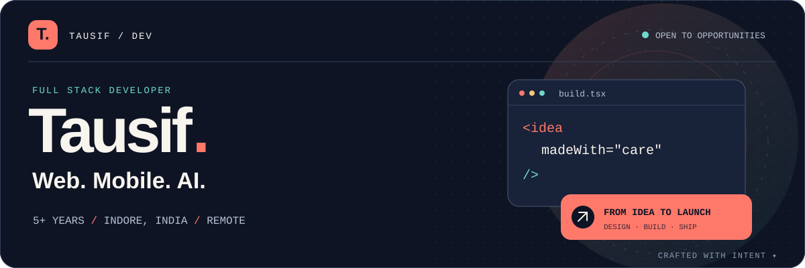
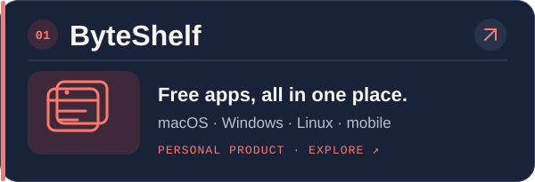
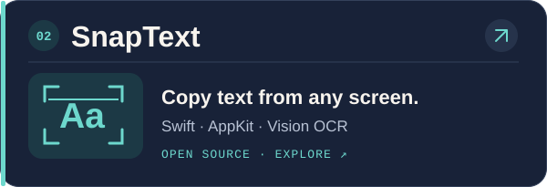
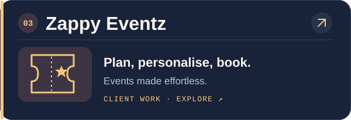
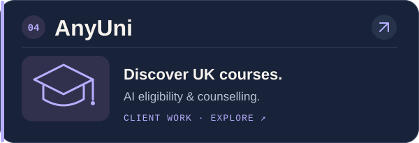
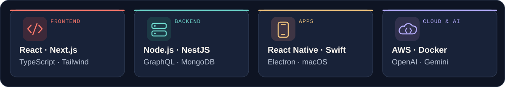
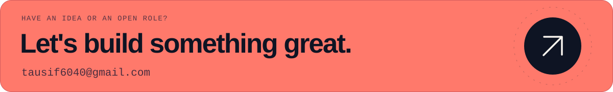

  <a href="https://www.tausif.info">
    <picture>
      <source media="(max-width: 600px)" srcset="./assets/banner-mobile.svg" />
      
    </picture>
  </a>

  
  
  

## ✨ Featured work

  
  

  
  

<a href="https://www.tausif.info/projects"><b>All projects ↗</b></a>

## 👋 About me

**Tausif** · Full Stack Developer · 📍 Indore, India

⚡ **5+ years** building web, mobile and desktop products. I work across UI, APIs and delivery, and enjoy turning useful ideas into polished software.

🌍 Open to **freelance, full-time and remote** opportunities.

## 🧰 Toolkit

<picture>
  <source media="(max-width: 600px)" srcset="./assets/stack-mobile.svg" />
  
</picture>

React · Next.js · TypeScript · Node.js · NestJS · React Native · Swift · AWS · AI APIs

 

<a href="mailto:tausif6040@gmail.com">
  <picture>
    <source media="(max-width: 600px)" srcset="./assets/contact-mobile.svg" />
    
  </picture>
</a>

  <a href="mailto:tausif6040@gmail.com">Email</a> &nbsp;·&nbsp;
  <a href="https://www.linkedin.com/in/muhammad-tausif">LinkedIn</a> &nbsp;·&nbsp;
  <a href="https://wa.me/918804236040">WhatsApp</a> &nbsp;·&nbsp;
  <a href="https://github.com/tausif40?tab=repositories">GitHub</a>

